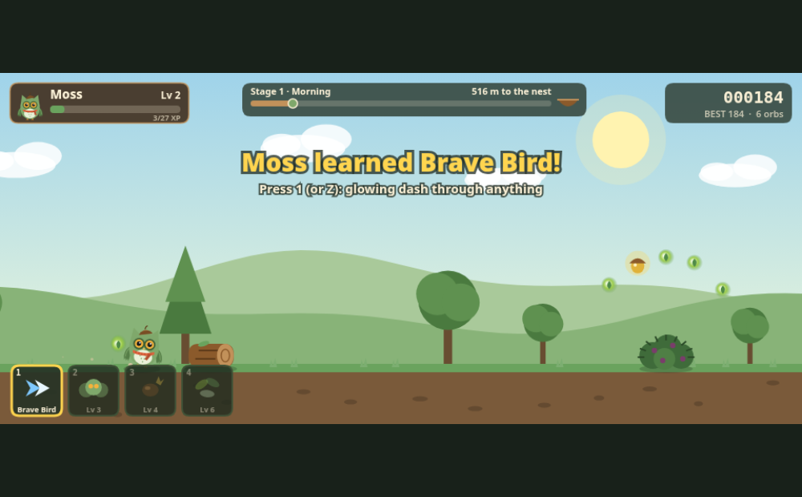

# Moss Run

A small arcade runner: hop, glide and level up your way home to the nest.

**▶ Play it: https://mj-baltasar-developer.github.io/moss-runner/**

## Make your own runner

On the start screen, describe your character in a few words and it gets drawn for you.
Try `moss`, `blue robot with sunglasses`, `pink cat with a gold crown`, `orange fox wizard`
or `rainbow slime with a halo`.

## Controls

| Key | Action |
|---|---|
| Space / tap | Hop (tap lightly for a small hop) |
| Hold Space | Glide |
| 1 / Z | Brave Bird: glowing dash through anything (Lv 2) |
| 2 / X | Double Team: decoys take one hit (Lv 3) |
| 3 / C | Seed Bomb: blasts the obstacles ahead (Lv 4) |
| 4 / V | Leaf Storm: clears the screen (Lv 6) |
| P / M | Pause / mute |
| E | Change runner after a run |

Collect leaf orbs and golden acorns to earn XP. Each stage ends at the nest, and the next one is longer and faster.

## Run locally

It's a single `index.html` with no dependencies. Open it in any modern browser.
